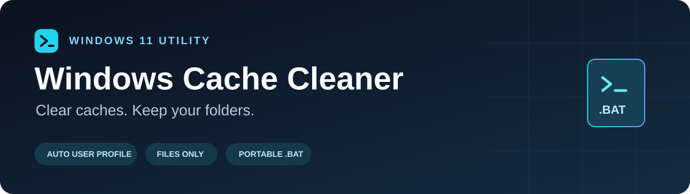

<p align="center">
  
</p>

<p align="center">
  <a href="https://github.com/gabriele-gaudissard/windows-cache-cleaner/releases/latest/download/Clean-Windows-Cache.bat"></a>
  
  <a href="LICENSE"></a>
</p>

# Windows Cache Cleaner

**Clear selected Windows caches and temporary files with one portable `.bat`. Your user profile is detected automatically.**

A small, readable Windows 11 cleanup utility with a deliberately limited list of targets. It keeps folder structures, checks paths before deletion, skips open browser caches, and continues when a target is missing.

**[Download the latest BAT](https://github.com/gabriele-gaudissard/windows-cache-cleaner/releases/latest/download/Clean-Windows-Cache.bat)** · **[Read the script](Clean-Windows-Cache.bat)** · **[Report an issue](https://github.com/gabriele-gaudissard/windows-cache-cleaner/issues)**

## Why use it?

- **Automatic account detection:** uses `%USERPROFILE%`, with no username to edit.
- **Portable:** one file, using Command Prompt and Windows PowerShell already included with Windows 11.
- **File-only cleanup:** folders and subfolders remain in place.
- **A small allowlist:** temporary files, Direct3D/NVIDIA caches, and selected Chrome/Edge caches.
- **Conservative path checks:** skips a whole target if inspection fails or finds a symbolic link, junction, or other reparse point.
- **Readable source:** no downloads, telemetry, registry changes, service changes, or scheduled background tasks in the script.

This is a cache cleanup utility. It does not promise an FPS boost, faster Windows, or a fixed amount of reclaimed space.

## Quick start

1. Save your work and close applications, including Chrome and Edge.
2. Download **[Clean-Windows-Cache.bat](https://github.com/gabriele-gaudissard/windows-cache-cleaner/releases/latest/download/Clean-Windows-Cache.bat)** from the latest release. Keep it somewhere outside the cleanup targets, such as Downloads or Desktop.
3. Open the file in a text editor if you want to review the commands first.
4. Double-click it from the Windows account you want to clean. A normal, non-administrator launch is sufficient.
5. Read the console output. Press a key when it finishes.

**Deletion is permanent and does not use the Recycle Bin.** Do not store documents or work you need to keep in temporary/cache folders. Close installers and applications before running it.

The script starts cleaning immediately; there is no separate confirmation or preview mode. It does not request administrator privileges. Running it under another account targets that account's profile.

## Exactly what it cleans

Paths are resolved at runtime; a missing folder is simply skipped.

| Category | Allowed location | Behavior |
| --- | --- | --- |
| User temporary files | `%USERPROFILE%\AppData\Local\Temp` | Deletes accessible files recursively; preserves folders. |
| Windows temporary files | `%SystemRoot%\Temp` | Usually `C:\Windows\Temp`; permissions may cause it to be skipped. |
| Direct3D shader cache | `%USERPROFILE%\AppData\Local\D3DSCache` | Cache files only. |
| NVIDIA DirectX cache | `%USERPROFILE%\AppData\Local\NVIDIA\DXCache` | Cache files only. |
| NVIDIA OpenGL cache | `%USERPROFILE%\AppData\Local\NVIDIA\GLCache` | Cache files only. |
| Chrome cache | `%USERPROFILE%\AppData\Local\Google\Chrome\User Data\Default\Cache` | Skipped if a `chrome` process is detected. |
| Chrome code cache | `%USERPROFILE%\AppData\Local\Google\Chrome\User Data\Default\Code Cache` | Same browser check. |
| Chrome GPU cache | `%USERPROFILE%\AppData\Local\Google\Chrome\User Data\Default\GPUCache` | Same browser check. |
| Edge cache | `%USERPROFILE%\AppData\Local\Microsoft\Edge\User Data\Default\Cache` | Skipped if an `msedge` process is detected. |
| Edge code cache | `%USERPROFILE%\AppData\Local\Microsoft\Edge\User Data\Default\Code Cache` | Same browser check. |
| Edge GPU cache | `%USERPROFILE%\AppData\Local\Microsoft\Edge\User Data\Default\GPUCache` | Same browser check. |
| Session temporary files | `%TEMP%` | Only accepted when it resolves to the standard user Temp location or Windows Temp. A custom Temp path is skipped. |

The final TEMP step includes this command, **after validation**:

```bat
del /q /f /s "%temp%\*"
```

`/q` suppresses confirmation, `/f` allows deletion of read-only files, and `/s` includes subfolders. These switches do not override file locks or access permissions. Microsoft documents the command [here](https://learn.microsoft.com/en-us/windows-server/administration/windows-commands/del).

## What it leaves alone

The script has no cleanup targets for personal files, Downloads, Documents, Desktop, the Recycle Bin, browser bookmarks/passwords/history/cookies, or other users' profiles. Browser coverage is limited to the three cache folders of the **Default** profile.

It does not clean `WinSxS`, `System32`, `Installer`, `SoftwareDistribution`, `Prefetch`, Windows.old, restore points, or Windows Update/Delivery Optimization storage. It does not stop services or delete folders.

For wider Windows-managed cleanup, use Windows Settings → System → Storage → Temporary files, or [Storage Sense](https://support.microsoft.com/en-us/windows/experience/storage-filemanagement/manage-drive-space-with-storage-sense).

## How the checks work

For each target, the embedded PowerShell validator:

1. Normalizes the path and compares it against the allowed locations.
2. Verifies that the directory exists and does not contain the running BAT file.
3. Checks whether the relevant browser is running.
4. Checks the target and all its ancestors for reparse points.
5. Walks the target tree without following reparse points. Any link or inspection error skips the entire target.

Only a successful check permits `del` to run. PowerShell performs validation; Command Prompt performs file deletion. There is no `rd`/`rmdir` command.

These checks reduce accidental cleanup outside the intended targets, but inspection and deletion are separate operations. They do not eliminate races if another program changes the tree or starts a browser between the check and deletion. Use it on a normal personal machine with applications closed, not as a security boundary against hostile processes.

## Requirements and limitations

- Designed for Windows 11, with Command Prompt and Windows PowerShell 5.1 available. PowerShell 7 is not required.
- If Windows PowerShell is absent, no deletion is performed. If validation is blocked by policy, affected targets are skipped.
- Standard `%USERPROFILE%\AppData\Local` locations are used. Redirected AppData, portable browsers, additional browser profiles, Firefox and other GPU cache locations are not covered.
- Cloud placeholders or any other reparse points cause their entire target to be skipped.
- There is no age filter: accessible files in an allowed target can be deleted regardless of their age.
- Some hidden/system files may remain. Locked and inaccessible files remain too.
- Deletion output is suppressed. `Finished` means the routine ended, not that every file was removed or every target was cleaned.
- Caches will be rebuilt by applications. Their first launch may take longer afterward.
- No space report, automatic updates, dry run, undo, or background scheduling is included.

## Troubleshooting

| Symptom | Explanation / next step |
| --- | --- |
| A path says `Skipped` | It may be missing, contain a reparse point, fail inspection, or have its browser running. The console does not distinguish every reason. |
| Chrome/Edge caches are skipped after closing the window | The browser may still be running in the background. Close background processes through the browser's settings or Task Manager, then rerun. |
| Windows Temp is skipped | A normal account may not be able to inspect the whole tree. Skipping is expected; use Windows Storage settings for broader cleanup. |
| `%TEMP%` is skipped | A custom TEMP path is outside the supported locations, or its tree cannot be fully validated. |
| Empty folders remain | Expected: the script intentionally keeps all directories. |
| Little space is reclaimed | Targets may already be small, skipped, locked, or protected. Cleanup is not a guaranteed performance improvement. |
| Windows or company security policy blocks the file | Review the source and follow your organization's policy. Do not disable security protections to run it. |

## Testing

The repository includes fixture-based checks for automatic profiles (including spaces in paths), recursive file cleanup, directory preservation, missing targets, junction rejection and disallowed TEMP paths.

```powershell
powershell -NoProfile -File .\tests\Verify-Cleanup.ps1
```

The tests execute a modified copy against newly created fixture profiles. The Windows Temp cleanup call is disabled in that copy; `%USERPROFILE%` and `%TEMP%` are redirected to the fixtures for the child process. They never run the production BAT against your real profile. Test fixtures are retained for inspection. A GitHub Actions workflow runs the same checks on Windows.

Passing fixture tests is not certification across every Windows configuration.

## Contributing

Bug reports and small, well-scoped improvements are welcome. Include the Windows version, launch method, sanitized skipped path and reproduction steps. Do not upload personal cache contents, account details or credentials.

Changes that add cleanup locations should explain why they contain disposable cache/temporary data and include a fixture test for path boundaries. Keep the utility readable and the default scope conservative.

If this helps you, a star makes the project easier for other Windows users to discover.

## License

[MIT](LICENSE). Provided as-is; review the commands before use.
